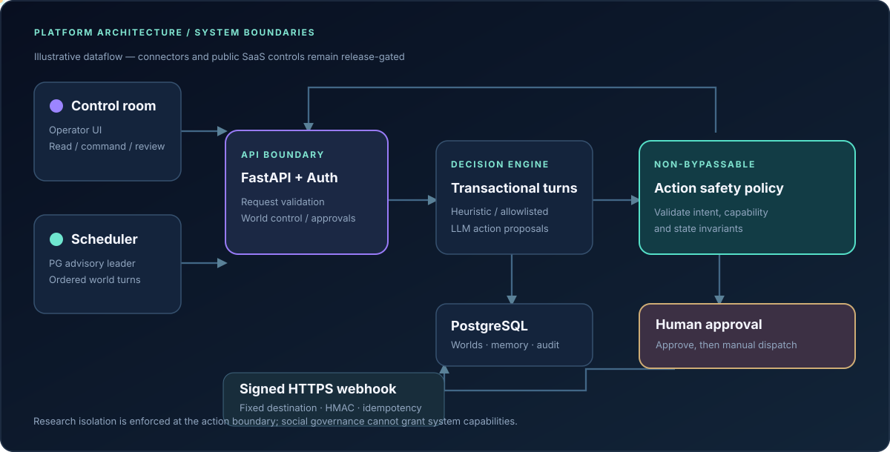
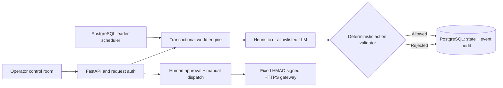
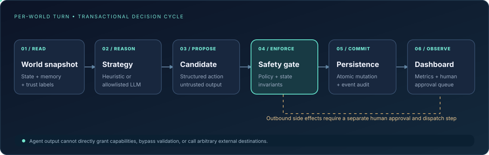
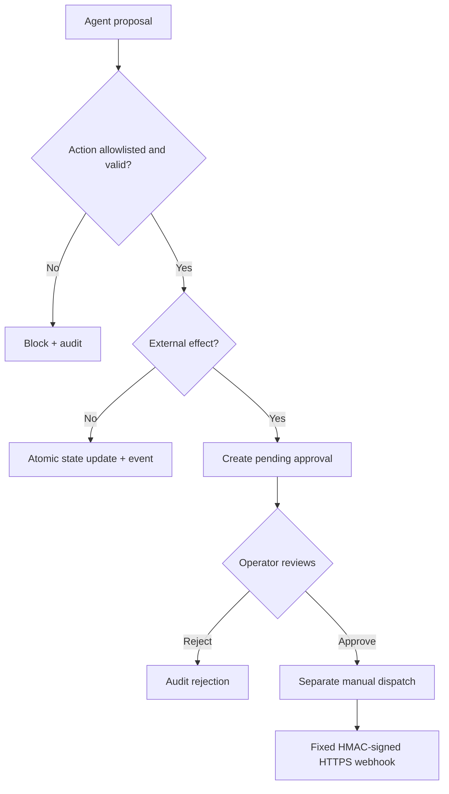

<div align="center">



<br />

# Falvorn WorldOps

**A governed control plane for autonomous multi-agent worlds.**  
Explore social dynamics in persistent simulations, trace every decision, and keep real-world side effects behind human authorization.

<br />

[](CHANGELOG.md)
[](backend/pyproject.toml)
[](docs/API.md)
[](docs/ARCHITECTURE.md)
[](SECURITY.md)
[](LICENSE)

<br />

[**Explore showcase**](docs/showcase/index.html) · [**Get started**](#-quickstart) · [**Architecture**](#-animated-architecture) · [**Security model**](#-safety-by-architecture) · [**Full documentation**](#-documentation)

<br />

> **Release status — controlled pilots.** Source is publicly viewable, but it is **not open-source software** and **not production-certified for public multi-tenant SaaS**. See [release gates](docs/RELEASE_CHECKLIST.md). Animated visuals are conceptual and the standalone showcase uses simulated data.

</div>

---

## ✦ Why WorldOps?

Multi-agent systems become interesting when individual decisions interact across time: agents remember, trade, coordinate, misinterpret, disagree, and influence each other. A compelling simulation is not just a chat window full of personas. It needs **state**, **repeatability**, **observability**, and **rules that cannot be rewritten by the agents themselves**.

WorldOps separates *agent intent* from *system authority*. It combines a persistent world engine with bounded agent strategies, a transactional action validator, an append-only event trail, and a manual approval path for external effects.

<table>
<tr>
<td width="33%" valign="top">
<h3>◈ Persistent worlds</h3>
Seeded research towns and workplace environments with agents, locations, credits, energy, memory, and governance.
</td>
<td width="33%" valign="top">
<h3>✳ Observable behavior</h3>
Turn-by-turn state changes, event timelines, safety intercepts, memories with source labels, and reproducible evaluation runs.
</td>
<td width="34%" valign="top">
<h3>◇ Human authority</h3>
Agent-proposed external actions cannot execute by themselves. Operators review and deliberately dispatch via a configured signed gateway.
</td>
</tr>
</table>

## ◇ Product preview

The live application is a browser-native **WorldOps Control Center** served by FastAPI. It displays an isometric world, agent roster, metrics, activity timeline, and approval queue.

The companion interactive showcase is **zero-install HTML** with animated agents, a working run/step/reset control, scenario selection, and demonstration event feed. It illustrates the intended experience; it does **not** run backend inference or represent real scientific findings.

<div align="center">
<a href="docs/showcase/index.html"></a>

<sub>Illustrative animation — for actual application behavior, run the backend using the quickstart below.</sub>
</div>

| Experience | How to access | Connected to real backend? |
| :-- | :-- | :--: |
| **Control Center** | Start FastAPI → open [http://127.0.0.1:8000](http://127.0.0.1:8000) | ✅ |
| **Interactive showcase** | Serve [docs/showcase/index.html](docs/showcase/index.html) locally | ❌ |
| **OpenAPI explorer** | Start FastAPI → open [http://127.0.0.1:8000/docs](http://127.0.0.1:8000/docs) | ✅ |

To view the no-install animated showcase from the repository root:

```bash
python -m http.server 8088 --directory docs/showcase
```

Open **http://127.0.0.1:8088**. This is a locally served static preview, not a hosted service. To publish a public showcase URL, deploy only the static \`docs/showcase\` directory; see [SHOWCASE.md](docs/SHOWCASE.md).

## ⬡ Animated architecture



The diagram distinguishes **decision authority** from **execution authority**. All candidate actions are validated against server-defined capabilities and state constraints. Social world policies cannot unlock arbitrary shell, network, or external tool access.

<details>
<summary><b>Text-based architecture (accessible alternative)</b></summary>



</details>

**Design principles:** explicit trust boundaries · durable world state · isolated model adapters · provenance on memories · auditability · reversible experiments · human authorization for external effects.

For a full service-boundary walkthrough, concurrency assumptions, data invariants and scale-up plan, see [docs/ARCHITECTURE.md](docs/ARCHITECTURE.md).

## ↺ Decision cycle & workflow



Each turn is a serializable, ordered world operation in the supported PostgreSQL deployment:

1. **Read** committed world state, source-labeled memory, and untrusted feeds.
2. **Propose** a structured action using a reproducible heuristic or an allowlisted, OpenAI-compatible provider.
3. **Enforce** scenario, tool, credit, energy, location, and safety constraints on the server.
4. **Commit** permitted mutations and their event record within the transaction.
5. **Observe** the resulting state, metrics, and review queue.
6. **Approve separately** before a configured external action can be manually dispatched.

**Trust rule:** LLM output is an untrusted *proposal*, never an instruction to the host system. Unknown actions are rejected and audited.

## ✦ Capabilities at a glance

| Capability | Current implementation | Boundary / limitation |
| :-- | :-- | :-- |
| Persistent simulations | ✅ World state, locations, credits, energy, events | SQLite only for development |
| Agent strategies | ✅ Deterministic heuristic + OpenAI-compatible adapter | Native Claude/Gemini/Grok adapters not included |
| Long-horizon experiments | ✅ Seeded turns, memories, comparisons, evaluation runner | Not a reproduction of Emergence AI reported results |
| Agent social dynamics | ✅ Conversations, trust, proposals, votes | Governance cannot modify system permissions |
| Operator UI | ✅ Responsive dashboard with isometric map | Live state via refresh/polling, not WebSockets |
| Safety enforcement | ✅ Allowlisted actions, invariant checks, event audit | Does not guarantee models are immune to manipulation |
| Real-world action boundary | ✅ Approval then separate signed webhook dispatch | Only configured action types and destination |
| Worker coordination | ✅ PostgreSQL advisory scheduler leadership | Not a distributed inference/job queue |
| Public SaaS readiness | 🚧 Not completed | Needs SSO, tenancy, rate limits, monitoring and load tests |

### Two environments, one execution boundary

**Research town** — investigate cooperation, competition, memory provenance, resource use, policy discussions, and action rejection.

**Workplace lab** — test operational decisions where a model may *request* a task or summary, but a trusted operator must explicitly authorize any outward action.

## ⚡ Quickstart

**Requirements:** Python 3.11+ and a modern browser. No Node dependencies for the dashboard. The default deterministic agent mode needs **no paid LLM key**.

```bash
git clone https://github.com/hossain0707/Falvorn-WorldOps.git
cd Falvorn-WorldOps/backend

python -m venv .venv
source .venv/bin/activate             # Windows: .venv\Scripts\activate
pip install -e '.[dev]'
cp .env.example .env                  # Configure for local development
uvicorn app.main:app --host 127.0.0.1 --port 8000 --reload
```

Now visit **http://127.0.0.1:8000**. Create a world, leave the model on heuristic mode, and run ten turns. Local development permits no-key access; production must use appropriately configured authentication and network controls.

Optionally start the single scheduler in another terminal:

```bash
cd backend
python -m app.worker
```

The worker advances only running worlds. **Do not use multiple SQLite workers.**

### Private pilot deployment

```bash
cp infra/.env.example infra/.env
# Set strong, distinct credentials and exact CORS_ORIGINS in infra/.env
docker compose --env-file infra/.env -f infra/docker-compose.yml config
docker compose --env-file infra/.env -f infra/docker-compose.yml up --build -d
```

The Compose stack provides PostgreSQL, a migration job, API, and worker. It binds the API to localhost; run behind **TLS plus identity-aware access control/VPN**. It is **not** safe to expose an admin-key dashboard directly to the public internet. Follow [deployment](docs/DEPLOYMENT.md) and [operations](docs/OPERATIONS.md).

## ⛨ Safety by architecture



- **No arbitrary tools:** agents cannot execute arbitrary shell commands, browse unrestricted URLs, or choose external destinations.
- **No implicit authorization:** governance or prompt text cannot elevate host permissions.
- **Operator control:** external side effects are off until configured, approved, and manually dispatched.
- **Audit identity:** production operator keys are fingerprinted server-side; user-provided reviewer identities are not trusted.
- **Pilot restrictions:** native per-user SSO, tenant RBAC, centralized alerts, distributed queueing, and security/load tests are launch blockers.

See [SECURITY.md](SECURITY.md), [THREAT_MODEL.md](docs/THREAT_MODEL.md) and [RELEASE_CHECKLIST.md](docs/RELEASE_CHECKLIST.md).

## ▣ Run tests & evaluations

```bash
cd backend
pytest -q
python -m app.evaluations --turns 160 --seed 42 --output evaluation.json

cd ../frontend
npm run check
```

The evaluation compares seeded **heuristic simulations** with and without a simulated adversarial feed. Its output is research-sandbox telemetry, **not** a benchmark of Claude, GPT, Gemini or Grok and **not** a replication of any published paper.

Testing is intentionally local/manual; **GitHub Actions were not enabled**.

## ◫ Project structure

```text
Falvorn-WorldOps/
├── backend/
│   ├── app/
│   │   ├── api/                  # HTTP boundary
│   │   ├── core/                 # Config, database, auth
│   │   ├── domain/               # Schemas, persistence
│   │   └── services/             # Engine, safety, provider, gateway
│   ├── alembic/                  # Database migration
│   └── tests/                    # API, governance, safety tests
├── frontend/
│   ├── index.html                # Real control room
│   └── src/                      # JS modules + CSS
├── docs/
│   ├── assets/                   # Original animated SVGs
│   ├── showcase/                 # Standalone animated UX preview
│   ├── ARCHITECTURE.md
│   ├── SHOWCASE.md
│   ├── DEPLOYMENT.md
│   ├── THREAT_MODEL.md
│   └── RELEASE_CHECKLIST.md
├── infra/                        # Docker Compose + env template
├── scripts/                      # Maintenance utilities
├── AGENTS.md                     # Contributor/agent working conventions
└── README.md
```

## ▤ Documentation

| Guide | Purpose |
| :-- | :-- |
| [Architecture](docs/ARCHITECTURE.md) | Service boundaries, transaction model, memory and governance |
| [Interactive showcase](docs/SHOWCASE.md) | Demo truthfulness, local use, static deployment guidance |
| [API](docs/API.md) | Endpoint contracts and operator actions |
| [Deployment](docs/DEPLOYMENT.md) | Private deployment setup and infrastructure constraints |
| [Operations](docs/OPERATIONS.md) | Operational policies and resilience work |
| [Threat model](docs/THREAT_MODEL.md) | Prompt injection, authority boundaries, approval risks |
| [Release checklist](docs/RELEASE_CHECKLIST.md) | Implemented controls versus launch blockers |
| [Security](SECURITY.md) | Disclosure policy and security expectations |
| [Contributing](CONTRIBUTING.md) | Development collaboration rules |
| [Agent instructions](AGENTS.md) | Modular engineering conventions for AI coding assistants |

## ◇ Research foundation & independence

This is **original Falvorn AI software** informed by publicly discussed *long-horizon multi-agent behavior* research:

- [Emergence World: A Platform for Evaluating Long-Horizon Multi-Agent Autonomy](https://arxiv.org/abs/2606.08367)
- [Emergence World: Adversarial Stress-Testing of Long-Horizon Multi-Agent Systems](https://arxiv.org/abs/2609.17320)
- [EmergenceAI/Emergence-World research repository](https://github.com/EmergenceAI/Emergence-World)

It is **not affiliated with Emergence AI**, does not bundle its datasets/personas/assets, and does not claim to reproduce its experiments. Follow the original authors' separate non-commercial/research licensing terms for their materials.

## ◈ Public visibility ≠ open-source license

**© 2026 Falvorn AI. All rights reserved.** This publicly visible repository does **not** grant permission to copy, redistribute, modify or commercialize its proprietary code. Refer to [LICENSE](LICENSE) before reuse; contributions are subject to the project owner's terms.

<div align="center">
<br />
<b>FALVORN AI · WORLDOPS</b><br />
<sub>Build observable intelligence. Preserve human control.</sub><br /><br />
<a href="#falvorn-worldops">Back to top ↑</a>
</div>
