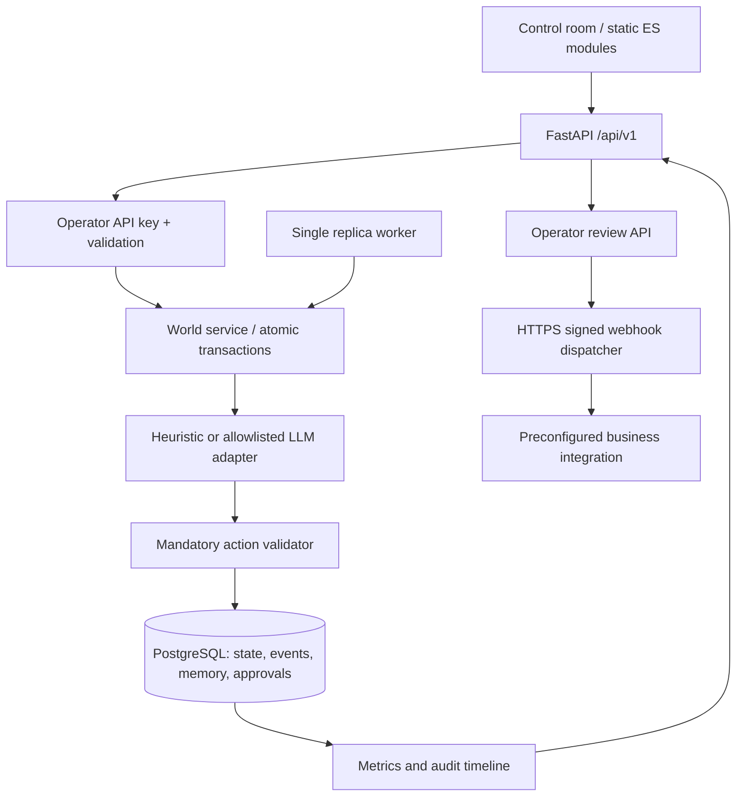

# System architecture

## Component boundaries

## Decision cycle

1. Lock a world row with `SELECT ... FOR UPDATE` (PostgreSQL); this guarantees serialized ordered steps per world.
2. Read ordered agents, context, verified memories, untrusted feed and eligible governance votes.
3. Select deterministic action or call an allowlisted model using a structured JSON decision contract.
4. Validate action against immutable programmatic allowlist plus scenario/location/energy/credits/peer preconditions.
5. Apply bounded state mutation; append audit `Event` and source-tagged `Memory` records in the **same DB transaction**.
6. Commit, then publish to the polling UI. A duplicate step request with the same idempotency key returns its stored result.

## Memory and trust

Agent memories are stored by `agent_id`, `world_id`, `kind`, source event and trust label. Core world event logs are append-only through the public API. Incoming external news/document-like content is **never** implicitly elevated to authority. A model may still be psychologically influenced by data; our goal is to preserve execution safety at the tool boundary, not claim perfect model immunity.

## World invariants

- Energy is constrained to [0,100] and credits to nonnegative integers.
- Unknown capability requests produce `blocked_action`, never runtime tool discovery.
- World policies are **social text**. They cannot grant network/code/shell capabilities or disable the approval gate.
- Outbound requests are `pending` until reviewed; only an operator can dispatch `approved` requests.
- Destinations and credentials come from environment configuration only.
- Agent controls and event counts are per-world; cross-world references are checked by the API.

## Scaling

Current scheduling is explicitly one worker replica. The DB row lock permits sequential world turns on PostgreSQL, but horizontally scaled workers would **over-schedule** a running world without a lease/queue. To scale: use a durable job queue (e.g., Temporal/Redis Streams), one world lease at a time, bounded concurrency, external model calls outside the long-lived DB transaction, and an outbox for side effects. These are future release gates, not present features.

## Provider limitations

`openai_compatible` is a single transport adapter using JSON chat-completion format. Provider credentials and model allowlists are operator-owned. It is not a general abstraction for arbitrary vendor APIs.

## Operator security (0.2.0)

All production world endpoints require an operator key. An optional distinct read-only key can only call GET endpoints. Approval reviewers are identified by a server-derived key fingerprint; request-supplied reviewer names are rejected. This is designed for one organization's private pilot; individual SSO identities and tenancy are still required for public hosting.

## Scheduler coordination (0.2.0)

PostgreSQL workers compete for a stable session advisory lock and only the leader advances worlds. Individual world steps also lock their world rows to serialize state mutations, including manual API steps. The lock does **not** eliminate long transactions during model calls, nor replace a distributed job queue.
